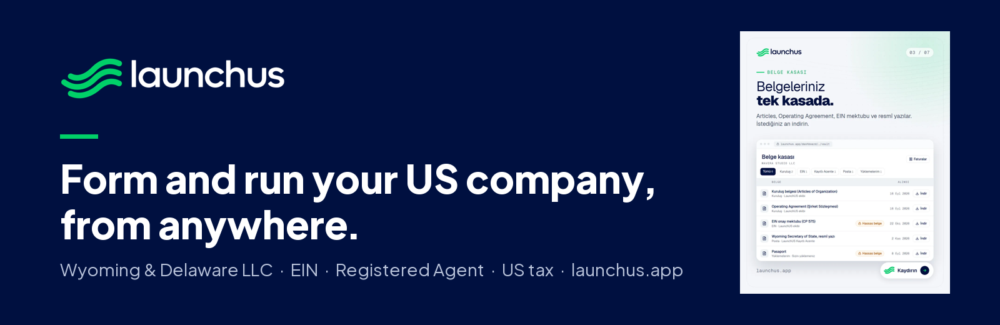
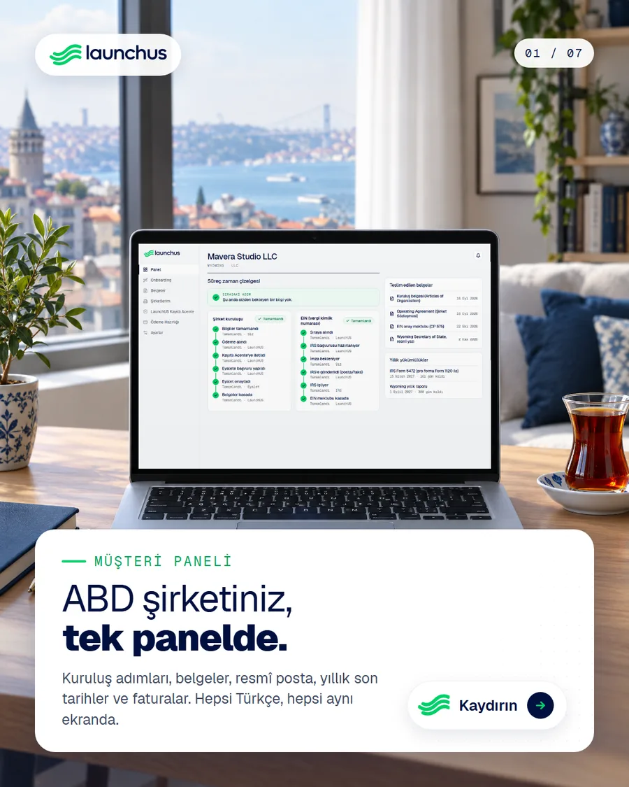
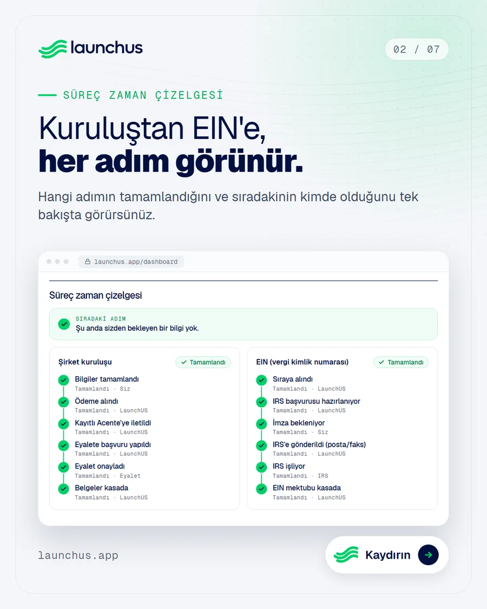
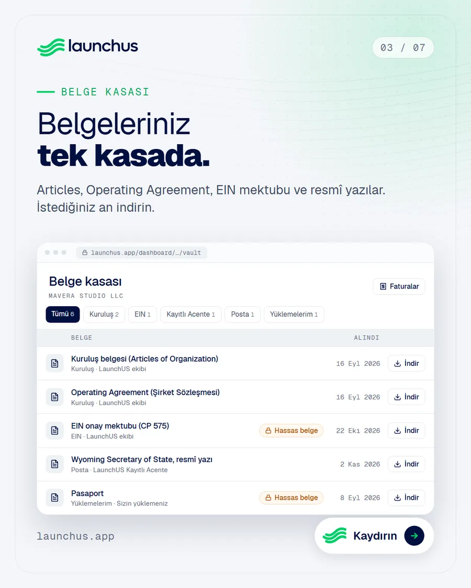
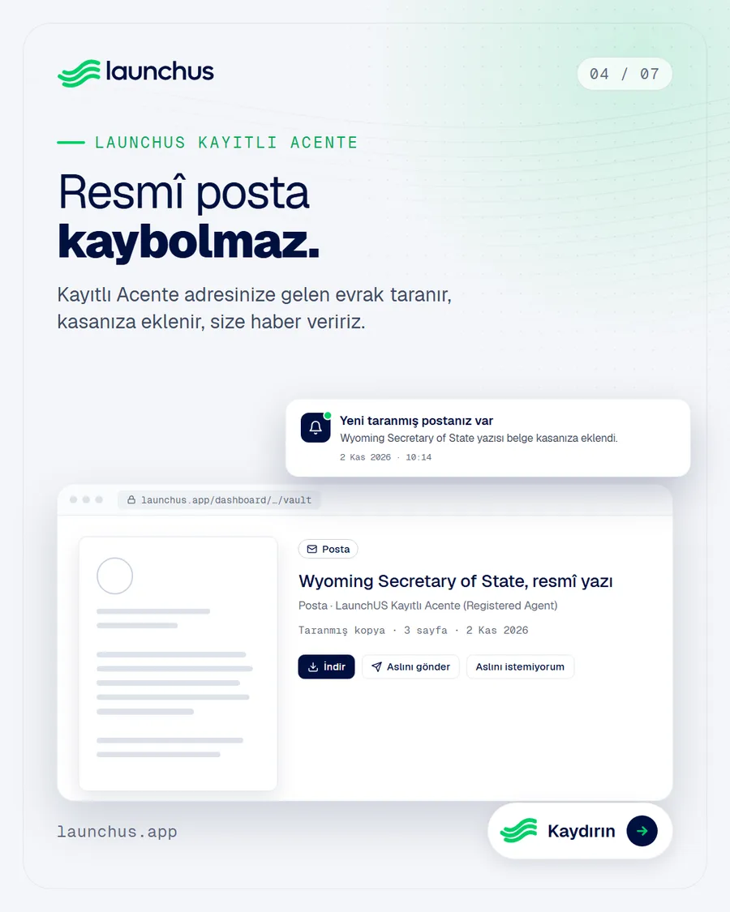
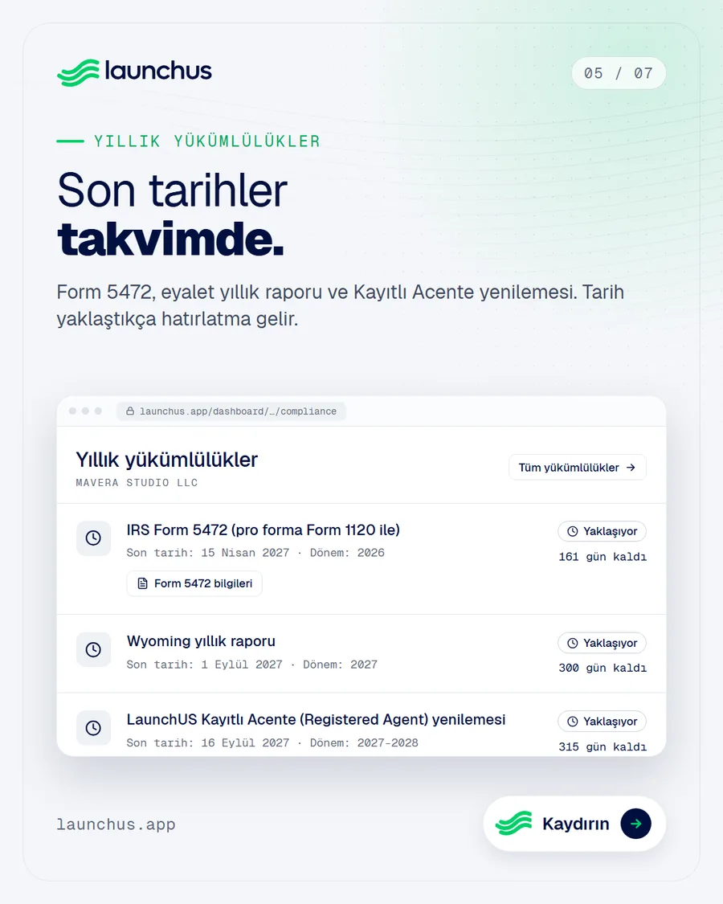
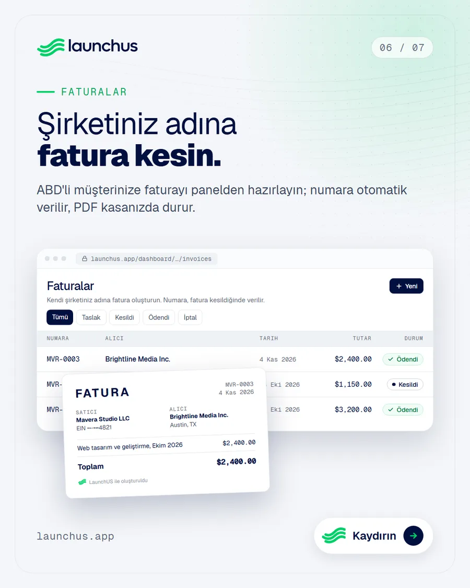
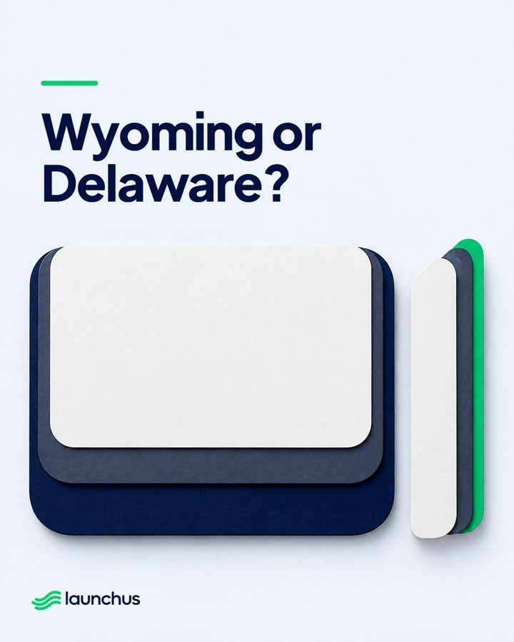
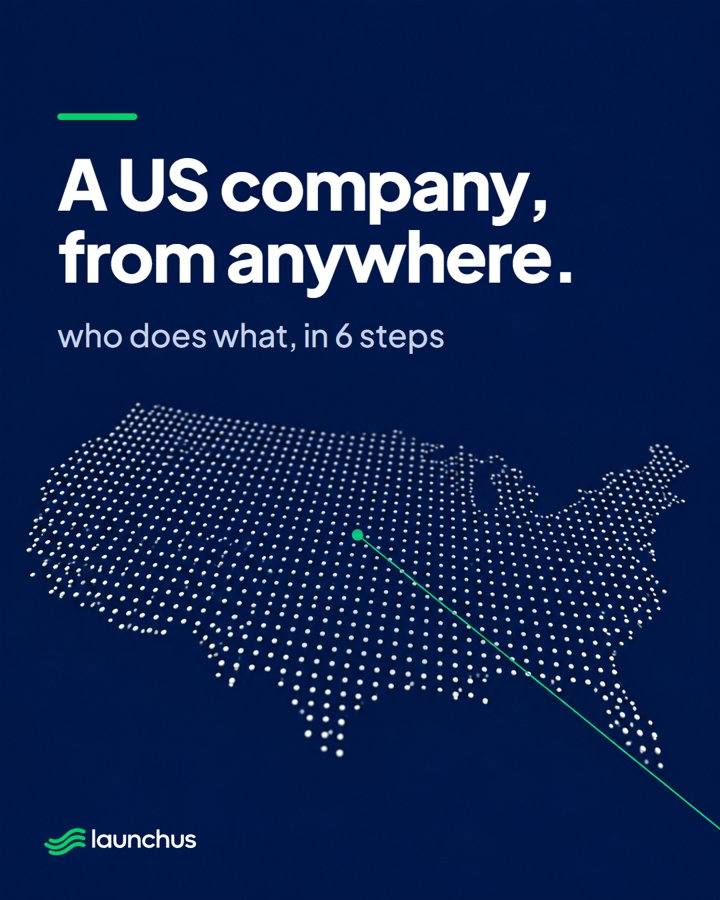
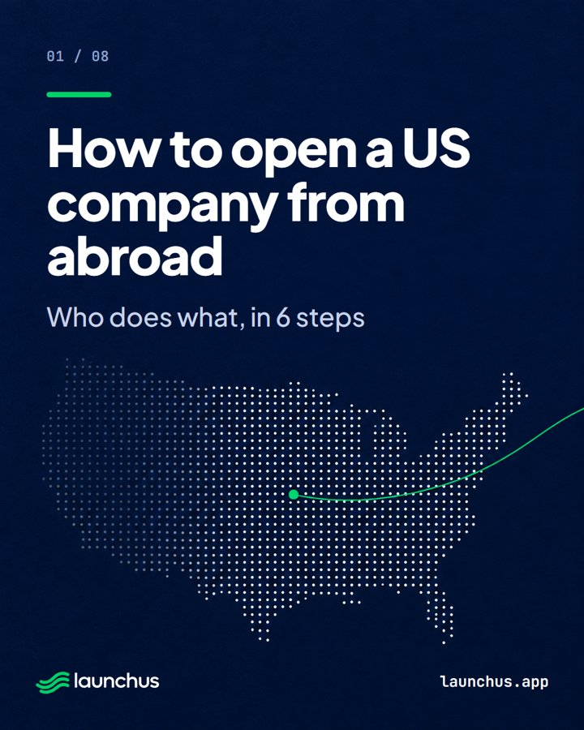

<p align="center">
  <a href="https://launchus.app/en"></a>
</p>

<p align="center">
  <a href="https://launchus.app/en"><b>launchus.app</b></a> ·
  <a href="https://launchus.app/en/pricing">Pricing</a> ·
  <a href="https://launchus.app/en/guides">Guides</a> ·
  <a href="https://launchus.app/en/tools">Free tools</a> ·
  <a href="https://launchus.app">Türkçe</a>
</p>

<p align="center">
  
  
  
</p>

# LaunchUS

**LaunchUS helps founders anywhere in the world form and run a US company: a Wyoming or Delaware LLC, the EIN, a registered agent, a US address, US tax filings and every yearly deadline, tracked in one customer panel.**

You tell us about your company once. We prepare and file the paperwork, keep your documents in one vault, scan your official mail and remind you before each deadline. You follow every step from the panel, in English or Turkish.

> This repository is the public home of LaunchUS on GitHub. It holds this overview and the **open-source calculators** that power the free tools on [launchus.app/en/tools](https://launchus.app/en/tools). The LaunchUS platform itself is not open source.

---

## What LaunchUS does

| Service | What you get |
|---|---|
| **US LLC formation** | Wyoming or Delaware LLC: name check, Articles of Organization / Certificate of Formation filed with the state, Operating Agreement. |
| **EIN (no SSN needed)** | We prepare Form SS-4 for your signature and apply to the IRS for your Employer Identification Number. |
| **LaunchUS Registered Agent** | A registered agent address in your state; official mail is scanned into your panel. |
| **Business address / Virtual Office** | A US street address for invoices, bank applications and mail. Each bank or payment provider makes its own decision. |
| **LaunchUS TAX** | Form 5472 with the pro forma Form 1120 and other US filings, prepared and signed by an independent US tax professional. |
| **Annual compliance** | Wyoming annual report, Delaware LLC tax, registered agent renewal: dates in your calendar, filings done for you. |
| **More** | DBA, LLC Health Check, ITIN, company closing (dissolution), invoices issued from your panel. |

Prices and package contents: **[launchus.app/en/pricing](https://launchus.app/en/pricing)**.

## The customer panel

Every step, document and deadline of your company in one place. (Screens show the fictional company *Mavera Studio LLC*.)

<table>
  <tr>
    <td width="33%"></td>
    <td width="33%"></td>
    <td width="33%"></td>
  </tr>
  <tr>
    <td align="center"><b>One panel</b><br><sub>Formation steps, documents, official mail, dates and invoices.</sub></td>
    <td align="center"><b>Timeline</b><br><sub>From formation to the EIN letter, every step visible.</sub></td>
    <td align="center"><b>Document vault</b><br><sub>Articles, Operating Agreement, EIN letter, state mail.</sub></td>
  </tr>
  <tr>
    <td></td>
    <td></td>
    <td></td>
  </tr>
  <tr>
    <td align="center"><b>Official mail</b><br><sub>Scanned into your vault, you get a notification.</sub></td>
    <td align="center"><b>Deadlines</b><br><sub>Form 5472, annual report, agent renewal.</sub></td>
    <td align="center"><b>Invoices</b><br><sub>Invoice your US clients in your company's name.</sub></td>
  </tr>
</table>

## How it works

1. **Tell us about your company** — state, name, members, business activity.
2. **We review and file** — the state filing, the registered agent and the Operating Agreement.
3. **EIN** — we prepare the SS-4 for your signature and apply to the IRS.
4. **Run the company** — documents, mail, invoices and yearly deadlines in your panel; LaunchUS TAX when filing season comes.

State and IRS processing times are set by the state and the IRS and can change.

## Free open-source tools

The calculators behind [launchus.app/en/tools](https://launchus.app/en/tools) are in [`tools/`](tools) under the MIT license: plain TypeScript, no dependencies, no network calls.

<table>
  <tr>
    <td width="33%"><a href="https://launchus.app/en/tools/do-i-need-form-5472"></a></td>
    <td width="33%"><a href="https://launchus.app/en/tools/form-5472-penalty-calculator"></a></td>
    <td width="33%"><a href="https://launchus.app/en/tools/wyoming-vs-delaware-cost-calculator"></a></td>
  </tr>
  <tr>
    <td align="center"><b>Do I need Form 5472?</b><br><sub><code>tools/src/form-5472-check.ts</code></sub></td>
    <td align="center"><b>Form 5472 penalty estimate</b><br><sub><code>tools/src/form-5472-penalty.ts</code></sub></td>
    <td align="center"><b>Wyoming vs Delaware cost</b><br><sub><code>tools/src/state-cost.ts</code></sub></td>
  </tr>
</table>

```ts
import { checkForm5472 } from './tools/src/form-5472-check.ts';
import { stateCost } from './tools/src/state-cost.ts';

checkForm5472(
  { usLlc: 'yes', members: 'single', foreignOwner: 'yes', corporateElection: 'no', reportableTransaction: 'yes' },
  2026,
);
// → { outcome: 'likelyRequired', reason: 'reportableTransaction', deadlines: { dueDate: '2027-04-15', ... } }

stateCost({ state: 'WY', years: 3 }).totalUsd; // 222.4 (state fees only)
```

Run the tests (Node 22.18+): `cd tools && npm test`. Details: [tools/README.md](tools/README.md).

The tools give estimates from published IRS and state figures; they are not tax or legal advice. Fees change: check the official source linked next to each figure.

## From our social channels

<table>
  <tr>
    <td width="33%"></td>
    <td width="33%"></td>
    <td width="33%"></td>
  </tr>
</table>

Follow LaunchUS: [LinkedIn](https://www.linkedin.com/company/launchusapp) · [X](https://x.com/launchusapp) · [Instagram](https://www.instagram.com/launchus.app) · [Facebook](https://www.facebook.com/launchusapp) · [YouTube](https://www.youtube.com/@launchusapp)

---

## Türkçe

**LaunchUS, dünyanın her yerinden girişimcilerin ABD şirketi kurmasına ve yönetmesine yardım eder:** Wyoming veya Delaware LLC, EIN, LaunchUS Kayıtlı Acente (Registered Agent), ABD adresi, ABD vergi beyanları (LaunchUS TAX) ve yıllık yükümlülükler. Her adımı Türkçe müşteri panelinden takip edersiniz.

- Fiyatlar ve paketler: [launchus.app/fiyatlar](https://launchus.app/fiyatlar)
- Rehberler: [launchus.app/rehber](https://launchus.app/rehber)
- Ücretsiz araçlar: [launchus.app/araclar](https://launchus.app/araclar) (kaynak kodu bu repodaki `tools/` klasöründe, MIT lisansı)

## Contact

- Website: [launchus.app](https://launchus.app/en)
- Customers: support@launchus.app
- Partnerships and press: hello@launchus.app

## License

The code in [`tools/`](tools) is released under the [MIT License](LICENSE). The LaunchUS name, logo, screenshots and images in `docs/images/` are © LaunchUS and are not covered by the MIT license.
